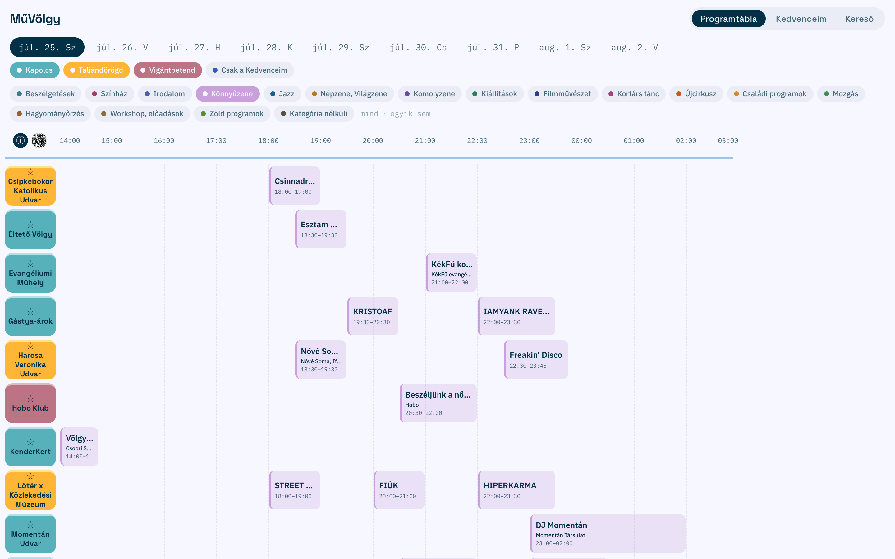
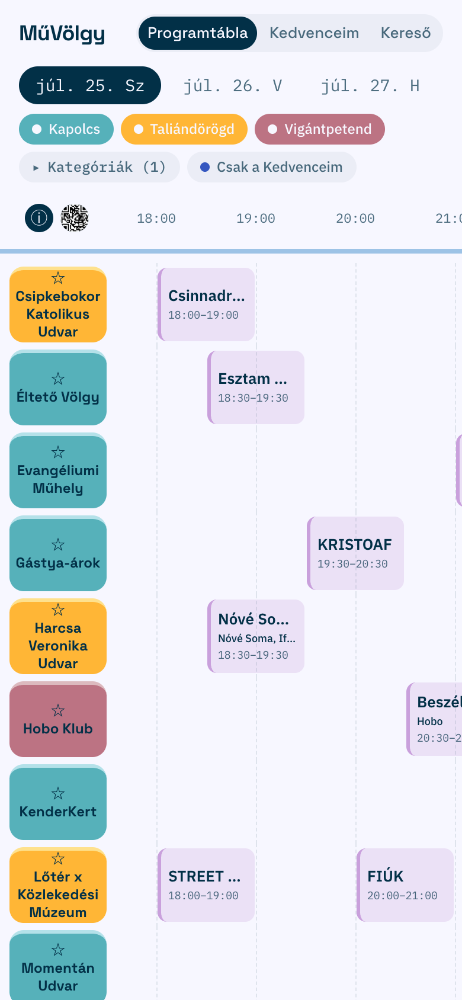
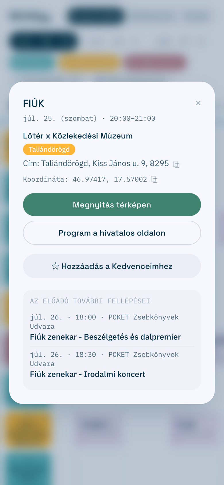

# MűVölgy – programtábla

Nem hivatalos, személyes programkereső a **Művészetek Völgye 2026** fesztiválhoz.
A hivatalos oldalon nehéz átlátni, mely koncertek ütköznek egymással a különböző
helyszíneken. Ez az app ugyanazokat a nyilvános fesztiváladatokat idő × helyszín
táblázatban mutatja, így az átfedések egy pillantással látszanak.

Élő oldal: **[muvolgyprogi.hu](https://muvolgyprogi.hu)**



<p>
  
  &nbsp;
  
</p>

## Mit tud?

- **Programtábla** – napokra bontva, helyszínenként egy sor, a programok valós
  hosszukkal; az egymással ütköző programok azonnal látszanak.
- **Szűrők** – település (Kapolcs, Taliándörögd, Vigántpetend) és kategória szerint.
- **Kedvencek** – programok és helyszínek csillagozása; a kedvenc helyszínek a
  táblázat tetejére kerülnek.
- **Barátok** – a kedvencek QR-kóddal megoszthatók, a barátok választásai
  ráhúzhatók a táblázatra.
- **Kereső** – előadókra és helyszínekre.
- **Offline is működik** (PWA), telefonra telepíthető.

## Fejlesztés

```bash
npm install
npm run dev     # http://localhost:3000
npm run build   # éles build (típusellenőrzéssel)
```
